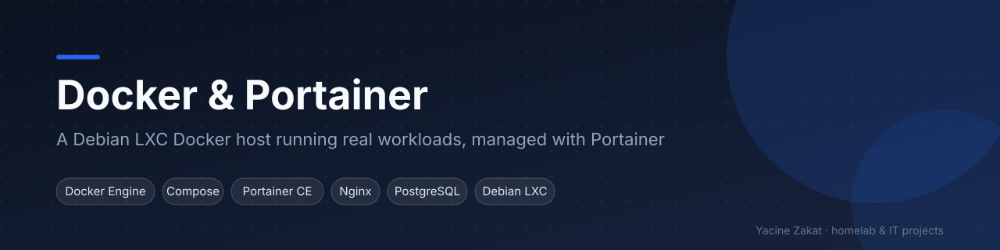
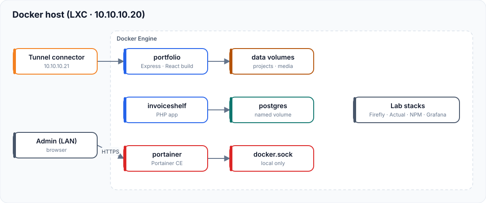

# Docker & Portainer Homelab

The Docker host of my Proxmox homelab: an unprivileged Debian LXC running real workloads with Docker Compose, managed through Portainer.

| | |
|---|---|
| **Status** | In production in my homelab |
| **Stack** | Debian 12 LXC (Proxmox VE) · Docker Engine · Docker Compose · Portainer CE · Nginx · PostgreSQL |
| **Related** | [Proxmox homelab](https://github.com/bugHunte3R/Proxmox) · [Portfolio](https://github.com/bugHunte3R/React-Portfolio-V3) · [Cloudflare Zero Trust](https://github.com/bugHunte3R/Cloudflare-zerotrust) |

## Architecture

| Workload | How it runs | Exposure |
|---|---|---|
| Portfolio (React build on Nginx) | Container, multi-stage image | Public via Cloudflare Tunnel |
| Portfolio contact API (Node.js / Express) | systemd service on the host | Internal, behind Nginx `/api/` |
| InvoiceShelf + PostgreSQL | Compose project, named volume, health checks | Private network only |
| Portainer CE | Container | Private network only |
| Lab stacks (Firefly III, Actual Budget, Nginx Proxy Manager, Prometheus + Grafana) | Compose projects kept for testing | Started on demand |

Network devices (UniFi) are **not** on this host: the UniFi OS Server runs in its own LXC so it can be backed up and upgraded separately.

## What I did

- Ran Docker inside an unprivileged LXC (`nesting` + `keyctl`) to keep the whole host snapshot-able from Proxmox
- One Compose project per application, each with its own network and named volumes
- Multi-stage builds (Node build → Nginx runtime) for small production images
- `restart: unless-stopped` + container health checks; secrets in `.env` files outside Git
- Kept the old image tagged before every redesign of the portfolio for instant rollback
- Regular cleanup (`docker image prune`, builder cache) to protect a 24 GB root disk

## Fictional addressing used in this repository

| Role | Address |
|---|---|
| Docker host (LXC) | `10.10.10.20` |
| Tunnel connector | `10.10.10.21` |
| Homelab network | `10.10.10.0/24` |

## Documentation

[Architecture](docs/architecture.md) · [Docker host](docs/docker-host.md) · [Portainer](docs/portainer.md) · [Services](docs/services.md) · [Networking](docs/networking.md) · [Storage](docs/storage.md) · [Backups](docs/backup-strategy.md) · [Monitoring](docs/monitoring.md) · [Security](docs/security.md) · [Troubleshooting](docs/troubleshooting.md) · [Roadmap](docs/future-improvements.md)

Templates: [examples/](examples/) · helper scripts: [scripts/](scripts/)

## Skills demonstrated

Docker · Docker Compose · image builds · container networking · persistent volumes · Portainer · Linux/systemd · LXC · backup and rollback planning

---
**Yacine Zakat** — IT Support & Application Support Technician
