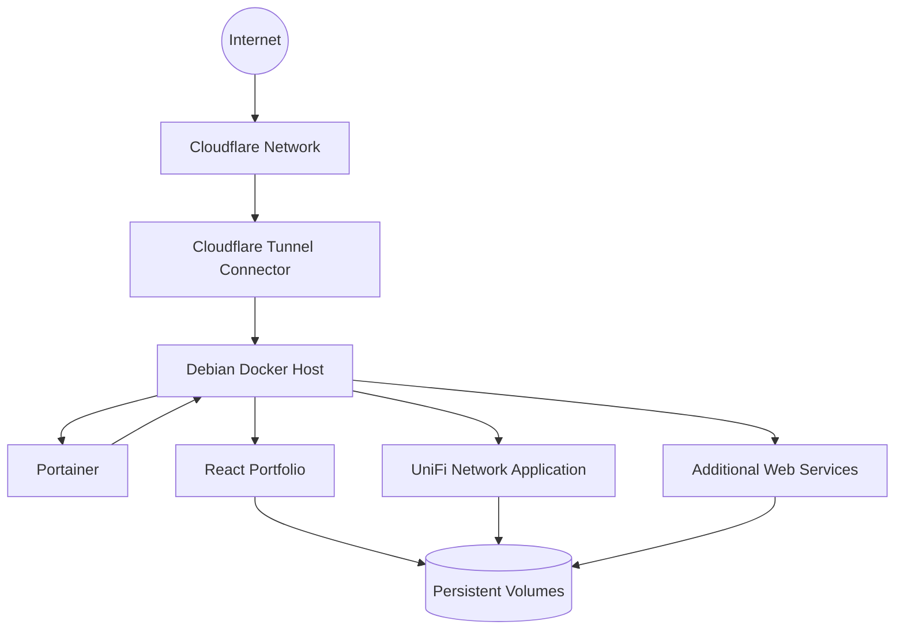

# Docker & Portainer Homelab


## Overview

This repository presents the Docker and Portainer environment used in my personal homelab.

The platform runs inside a dedicated Debian Linux container hosted on Proxmox VE and is used to deploy, manage and maintain several containerized services.

The goal of this project is to demonstrate practical experience with:

- Docker Engine
- Docker Compose
- Portainer
- Linux administration
- Container networking
- Persistent volumes
- Reverse tunnels
- Web application deployment
- Service isolation
- Secrets management
- Monitoring and troubleshooting
- Backup planning
- Technical documentation

> **Privacy notice:** this repository contains only sanitized documentation and example configurations. Real IP addresses, hostnames, domains, credentials, tokens, API keys, email addresses, container IDs and storage paths are excluded or replaced with placeholders.

---

## Architecture



Detailed documentation:

- [Architecture](docs/architecture.md)
- [Docker host](docs/docker-host.md)
- [Portainer](docs/portainer.md)
- [Hosted services](docs/services.md)
- [Networking](docs/networking.md)
- [Security](docs/security.md)
- [Persistent storage](docs/storage.md)
- [Backup strategy](docs/backup-strategy.md)
- [Monitoring and maintenance](docs/monitoring.md)
- [Troubleshooting](docs/troubleshooting.md)
- [Future improvements](docs/future-improvements.md)

---

## Platform Summary

| Component | Role | Technology |
|---|---|---|
| Docker Host | Runs containerized services | Debian Linux |
| Docker Engine | Container runtime | Docker |
| Docker Compose | Declarative application deployment | YAML |
| Portainer | Web-based container management | Portainer CE |
| React Portfolio | Public portfolio website | React, Node.js, Nginx |
| UniFi Network Application | Network management | Docker |
| Cloudflare Tunnel | Secure web publication | cloudflared |
| Persistent Volumes | Application data storage | Docker volumes and bind mounts |

---

## Docker Host

The Docker environment runs inside a dedicated Debian Linux container hosted on Proxmox VE.

Main responsibilities:

- Run Docker Engine
- Deploy applications with Docker Compose
- Centralize container logs
- Manage persistent volumes
- Isolate application networks
- Expose only required ports
- Provide a management interface through Portainer
- Host public and private services

The Docker host is separate from other infrastructure services such as the VPN server, private cloud and tunnel connector.

---

## Portainer

Portainer provides a web interface for managing the Docker environment.

It is used to:

- View running and stopped containers
- Review logs
- Inspect Docker networks
- Inspect volumes
- Manage Docker Compose stacks
- Restart services
- Review resource usage
- Deploy and update containers
- Troubleshoot container health

The Portainer administrative interface is treated as a private management service and is not intentionally exposed as a public application.

---

## Hosted Services

### React Portfolio

My personal portfolio is deployed as a containerized React application.

Deployment model:

```text
React source code
        |
        v
Node.js build stage
        |
        v
Production static files
        |
        v
Nginx container
        |
        v
Cloudflare Tunnel
        |
        v
Public visitors
```

Main technologies:

- React
- Node.js
- Nginx
- Docker
- Docker Compose
- Environment variables
- Cloudflare Tunnel

### UniFi Network Application

The UniFi Network Application runs as a Docker service and provides centralized management for compatible network equipment.

The service uses persistent storage to preserve configuration and application data across container recreation.

### Portainer

Portainer runs as a dedicated management container with access to the local Docker socket.

Its role is limited to administration of the Docker host.

### Additional Services

The environment can host additional web services, internal tools and test applications.

Exact service names, ports and domains are intentionally generalized in this public repository.

---

## Container Organization

```text
Docker Host
├── Management
│   └── Portainer
├── Public Web Services
│   └── React Portfolio
├── Network Services
│   └── UniFi Network Application
├── Supporting Services
│   └── Additional containers
├── Networks
│   ├── management-network
│   ├── web-network
│   └── internal-network
└── Storage
    ├── Docker volumes
    └── Bind mounts
```

---

## Networking Model

The public documentation uses reserved example values only.

```text
Docker host:      192.0.2.20
Portainer:        192.0.2.20:9443
Portfolio:        192.0.2.20:8080
UniFi:            192.0.2.20:8443
Example domain:   application.example.com
```

These values do not represent the real environment.

Container networking principles:

- Dedicated Docker networks when appropriate
- No unnecessary host-port exposure
- Private management services
- Public web services routed through a secure tunnel
- Database and internal service ports kept private
- Persistent container names avoided in public documentation when sensitive

---

## Security Approach

The Docker environment follows several security principles:

- Production secrets are never committed to Git
- `.env` files are excluded from version control
- Private management interfaces remain internal
- Only required ports are exposed
- Public applications use a secure reverse tunnel
- Containers are separated into logical networks
- Persistent data is stored outside container layers
- Images and operating systems are updated regularly
- Public documentation uses sanitized examples
- Backups are planned independently from containers

More details: [security.md](docs/security.md).

---

## Persistent Storage

Containers are treated as replaceable workloads.

Application data is stored using:

- Docker named volumes
- Bind mounts
- Application-specific data directories
- Database volumes
- Configuration directories

Example:

```yaml
volumes:
  portainer-data:
  application-data:
  unifi-data:
```

The real storage paths and backup destinations are not included in this repository.

---

## Deployment Workflow

Example workflow for a Docker Compose service:

```bash
cp examples/environment.example .env
cp examples/docker-compose.example.yml docker-compose.yml

docker compose config
docker compose pull
docker compose up -d
docker compose ps
docker compose logs --tail=100
```

The example files must be reviewed before use.

---

## Monitoring and Maintenance

The environment is maintained using:

- Portainer dashboards
- Docker CLI
- Container logs
- Docker health checks
- Disk-capacity checks
- Image-update reviews
- Service restart verification
- Application connectivity tests
- Backup verification
- Linux service monitoring

Generic commands:

```bash
docker ps
docker compose ps
docker compose logs --tail=100
docker stats
docker system df

systemctl status docker
journalctl -u docker --since today
df -h
free -h
```

---

## Troubleshooting Experience

This environment includes practical troubleshooting experience with:

- Containers failing to start
- Incorrect environment variables
- Docker Compose syntax errors
- Port conflicts
- Persistent volume permissions
- Application cache after rebuilds
- Old images remaining in use
- Reverse-tunnel routing
- Internal service reachability
- Docker network isolation
- Nginx configuration
- Application logs
- Container restart policies
- Service dependency ordering

See [troubleshooting.md](docs/troubleshooting.md).

---

## Skills Demonstrated

### Docker

- Docker Engine administration
- Docker Compose
- Container lifecycle management
- Image updates
- Container logs
- Networks
- Volumes
- Restart policies
- Health checks

### Portainer

- Stack management
- Container inspection
- Network inspection
- Volume inspection
- Log review
- Service restart
- Resource monitoring

### Linux

- Debian administration
- systemd
- Permissions
- Storage management
- Network troubleshooting
- Log analysis
- Shell scripting

### Web Deployment

- React production builds
- Node.js
- Nginx
- Environment variables
- Reverse tunnelling
- Static application hosting

### Security

- Secret separation
- Private management access
- Reduced port exposure
- Sanitized documentation
- Persistent data separation
- Backup planning

---

## Repository Structure

```text
.
├── README.md
├── SECURITY.md
├── LICENSE
├── .gitignore
├── docs/
│   ├── architecture.md
│   ├── docker-host.md
│   ├── portainer.md
│   ├── services.md
│   ├── networking.md
│   ├── security.md
│   ├── storage.md
│   ├── backup-strategy.md
│   ├── monitoring.md
│   ├── troubleshooting.md
│   └── future-improvements.md
├── diagrams/
│   ├── architecture-diagram.md
│   ├── container-network-diagram.md
│   └── deployment-flow.md
├── examples/
│   ├── docker-compose.example.yml
│   ├── portainer-compose.example.yml
│   ├── portfolio-compose.example.yml
│   ├── unifi-compose.example.yml
│   └── environment.example
├── scripts/
│   ├── docker-health-check.example.sh
│   ├── docker-cleanup.example.sh
│   ├── update-stacks.example.sh
│   └── backup-volumes.example.sh
└── screenshots/
    └── README.md
```

---

## Planned Improvements

Potential future improvements:

- Automated container update notifications
- Centralized monitoring
- Alerting for failed containers
- Centralized log collection
- Docker image vulnerability scanning
- More granular Docker networks
- Automated backup validation
- Infrastructure-as-code deployment
- Configuration management
- Staging and production separation
- High-availability experiments

---

## Privacy Notice

The following information has intentionally been removed or replaced:

- Real IP addresses
- Public IP addresses
- Domain names
- Email addresses
- Usernames
- Passwords
- API keys
- Tunnel tokens
- Docker secrets
- Container IDs
- MAC addresses
- Internal storage paths
- Real port mappings
- Database credentials
- SMTP credentials
- Personal files
- Router configuration
- Backup destinations

---

## Author

**Yacine Zakat**

IT Support and Application Support Technician with experience in Linux, Microsoft 365, virtualization, Docker, networking, web application deployment and self-hosted services.

This environment is used for continuous learning and practical infrastructure administration.

---

## Disclaimer

This repository is provided for demonstration and educational purposes.

All configurations are sanitized examples and should be reviewed before use in another environment.
